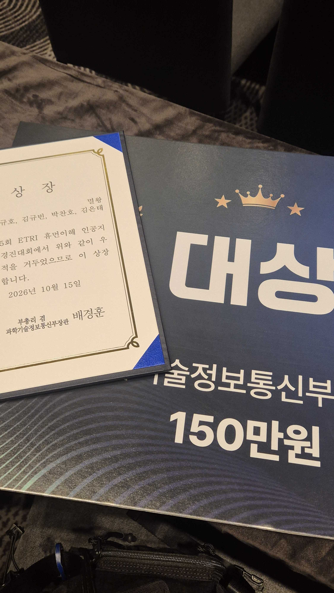

# SOLAR

**A Stepwise Sleep Prediction Framework via Long-Term Anchoring and Refinement**

> 🏆 **Grand Prize · 1st Place in the Final Overall Evaluation**<br>
> **멀왕팀 — 제5회 ETRI 휴먼이해 인공지능 논문경진대회 대상 · 과학기술정보통신부장관상**

Kyubin Kim*, Chanho Park*, Kyuho Lee*, Euntae Kim*<br>
Department of Computer Science, Korea University<br>
\* Equal contribution

[Project page](https://chanho12.github.io/etri_solar/) · [Paper](https://drive.google.com/file/d/18jN1ZuiLQeukAqOCAjvDY2MZCu7U_5IE/view?usp=sharing) · [Code](code/) · [Slides](docs/solar-slides.pdf) · [Model report](docs/model-report.pdf)

## 🏆 Grand Prize — Team 멀왕

**멀왕팀**은 **제5회 ETRI 휴먼이해 인공지능 논문경진대회**에서 **최종 종합평가 1위**를 차지하며 **대상(과학기술정보통신부장관상)**을 수상했습니다. 시상식은 **2026년 10월 15일, 제주 ICTC 2026**에서 진행되었습니다.

**Team 멀왕** at Korea University won the **Grand Prize (Minister of Science and ICT Award)** and **1st place in the final overall evaluation** of the **5th ETRI Human Understanding AI Paper Challenge**. The final award evaluation considers the research paper and reproducibility verification separately from the prediction leaderboard.

<p align="center">
  <a href="assets/awards/etri-grand-prize-2026.jpg">
    
  </a>
</p>
<p align="center"><sub>멀왕팀 대상 수상 — 과학기술정보통신부장관상 · 2026.10.15</sub></p>

**느낀점**

> 작년 팀들의 논문을 읽으면서 논문 작성에 최대한 기여하려고 했다. 말하고자 하는 바가 잘 전달되도록 논문 작성에 많은 시간을 썼고, 대학원생으로서 학위 과정 동안 배운 내용을 적용해 우리가 전하고자 하는 바를 명확하게 전달하려고 했다.

## About SOLAR

SOLAR predicts seven daily sleep-related probabilities from smartphone and wearable lifelog data. It separates long-term personalized anchoring, day-specific residual refinement, and target-specific history-aware refinement.

## Repository layout

```text
etri_solar/
├── index.html                  # GitHub Pages project page
├── assets/                     # Page styles, scripts, figures, local paper copy
├── code/                       # Raw-to-submission training implementation
│   ├── run.py
│   ├── solar_pipeline.py
│   ├── solar_core.py
│   ├── setup_conda.sh
│   ├── run_solar.sh
│   ├── environment.yml
│   ├── requirements.txt
│   └── data/README.md           # Required input layout; raw data is not included
└── docs/
    ├── MODEL_DESCRIPTION.md    # Detailed Korean technical documentation
    ├── model-report.pdf        # Supplied submission model report
    ├── solar-slides.pdf        # ICTC 2026 presentation
    └── solar-code.zip          # Standalone code and documentation bundle
```

## Reproduce the submission

Use a 64-bit Linux environment with Miniconda or Anaconda. Obtain the official challenge inputs separately and place them in [`code/data/`](code/data/README.md).

```bash
git clone https://github.com/chanho12/etri_solar.git
cd etri_solar/code
./setup_conda.sh
./run_solar.sh
```

The final output is `code/data/submissions/submission_final.csv`. See the [code instructions](code/README.md) and [model description](docs/MODEL_DESCRIPTION.md) for environment requirements, optional execution flags, and validation details. Raw participant data, trained checkpoints, generated features, and prediction CSVs are excluded from this repository.

## Reported results

Average test Log-Loss across seven targets; lower is better. These values are from the supplied paper, not a new training run.

| Method | Test Log-Loss ↓ |
|---|---:|
| CatBoost | 0.6053 |
| LightGBM | 0.6316 |
| XGBoost | 0.6985 |
| SCH CSM (CatBoost–LightGBM) | 0.6017 |
| **SOLAR** | **0.5560** |
